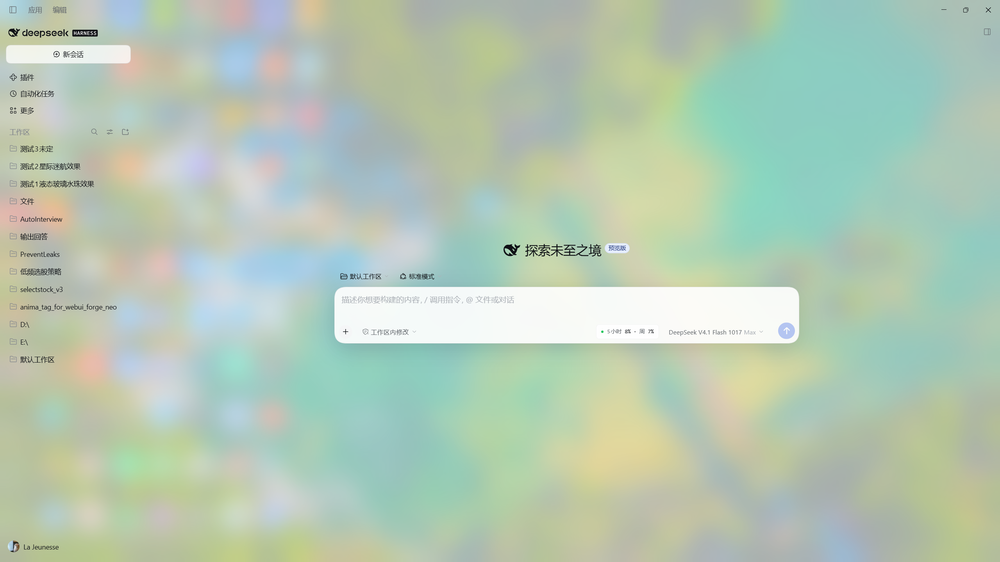
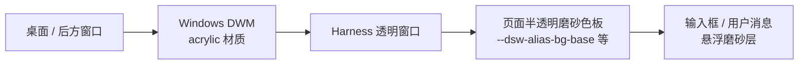

# DSH Desktop Glass · 桌面磨砂玻璃

给 **DeepSeek Harness Desktop** 的 Windows 原生亚克力磨砂玻璃插件。

它把整个 Harness 窗口变成**一整块连续的磨砂玻璃**：侧栏、顶栏、内容区、输入框不再有分区和分隔线，窗口后方的桌面通过 Windows 11 的 **acrylic（亚克力）** 材质实时模糊透出，文字保持清晰；输入框和已发送消息额外使用更浓厚的悬浮磨砂层。效果由 DWM 直接合成，**没有帧率设置，也没有采样延迟**。

> 插件基于 DSH 的 Host + Client 双半部插件机制编写，不依赖任何第三方 npm 依赖。可选的原生适配会修改 DSH 安装目录下的 `resources/app.asar`（自动备份、可一键恢复），详见下文。

## 特性

- **整窗连续玻璃**：统一的半透明色板，去掉 sidebar、titlebar、center column 之间的接缝和圆角。
- **Windows 11 原生 acrylic**：`transparent: true` + `backgroundMaterial: "acrylic"`，桌面画面由系统实时模糊；不是截屏轮询。
- **无帧率参数**：原生模式下不做窗口截图，不占用采样 CPU，也没有 fps 上限。
- **悬浮玻璃层**：输入框（composer）与已发送的用户消息使用独立的高斯模糊和浓度，默认比页面更浓。
- **设置页集中控制**：账号菜单 → **设置 → 桌面磨砂玻璃**；不占用左下角按钮。
- **明暗外观联动**：可跟随 Harness 内置外观自动选择白色/黑色磨砂，也可固定颜色。
- **可逆原生适配**：安装器只改 `lib/main.js` 两处，保持文件字节长度并重新计算 asar 完整性哈希；原文件自动备份。
- **自动回退**：未打补丁、DSH 升级覆盖 `app.asar`、系统不支持 acrylic 时，插件自动回退到旧的采样模式，不会白屏。
- **底部渐变条清理**：已覆盖侧栏会话列表的 `scrollFade` 和输入框下方 `composerSeat` 的白色渐变。

## 环境要求

| 项目 | 要求 |
| --- | --- |
| 系统 | Windows 11 22H2（build 22621）或更新版本 |
| 宿主 | DeepSeek Harness **Desktop**（Windows 桌面版），已在 44.7.0 / Electron 44 上测试 |
| 系统设置 | 设置 → 个性化 → 颜色 → **透明效果** 保持开启 |
| 原生适配 | 需要管理员权限？不需要；但需要能写入 DSH 安装目录（当前用户安装通常可写） |
| Node | 安装器使用 DSH 自带的 Node 运行时，无需另外安装 Node |

原生模式只在 **Windows 11** 上有效。Windows 10 或关闭透明效果时，插件会自动使用采样模式。

## 安装

### 1. 安装插件

在 Harness 的插件管理页安装本仓库：

- 从 GitHub 安装：仓库地址填 `https://github.com/<your-name>/dsh-desktop-glass`
- 或把本目录放到本机，用插件管理页的「从本地目录安装」

也可以使用 DSH CLI（以当前版本支持为准）：

```powershell
dsh plugin --profile desktop add github:<your-name>/dsh-desktop-glass
```

安装后插件位于：

```text
%USERPROFILE%\.dsh\profiles\desktop\node_modules\dsh-desktop-glass
```

### 2. 原生亚克力适配（推荐）

页面插件无法修改 Electron 的 `BrowserWindow`，所以“原生 acrylic”需要一次性的主程序适配。适配器会：

1. 在 Windows 主窗口选项中加入 `transparent: true` 和 `backgroundMaterial: "acrylic"`；
2. 把 `chromeFallbackFill()` 改为返回透明色，让运行期窗口底色与标题栏覆盖色保持透明；
3. 保持 `lib/main.js` 字节长度不变，仅更新该文件在 asar 头部的 SHA-256。

**先完全退出 Harness**（托盘右键 → 退出，不是关闭窗口），然后执行以下任意一种：

**A. 从已安装的插件目录运行（推荐）**

```bat
cd /d "%USERPROFILE%\.dsh\profiles\desktop\node_modules\dsh-desktop-glass"
native\apply-glass.cmd
```

**B. 从本仓库目录运行，并指定 DSH 安装目录**

```bat
cd /d "X:\path\to\dsh-desktop-glass"
native\apply-glass.cmd "D:\Path\To\DeepSeek Harness"
```

脚本会自动查找 DSH 安装目录（`%LOCALAPPDATA%\Programs\DeepSeek Harness` 等常见位置）；找不到时请按上面方式传入安装目录。它也会检查 Harness 是否仍在运行。

安装成功后重新打开 Harness。等待几秒，**设置 → 桌面磨砂玻璃** 顶部会显示：

> 原生亚克力已启用（Windows 11）

### 3. 启用效果

打开 **账号菜单（左下角头像）→ 设置 → 桌面磨砂玻璃**，打开「启用磨砂玻璃背景」即可。

## 设置

| 设置 | 默认 | 说明 |
| --- | --- | --- |
| 启用磨砂玻璃背景 | 开 | 关闭立即恢复原界面；采样器也会暂停 |
| 关联页面内置外观颜色 | 开 | 浅色外观用白色磨砂，深色用黑色磨砂 |
| 玻璃颜色 | 白 | 关闭关联后固定使用白色/黑色 |
| 页面玻璃浓度 | 48% | 整块页面玻璃的透明度，越低越透 |
| 悬浮层高斯模糊程度 | 42px | 输入框与已发送消息的 CSS 模糊；原生模式下只影响页面内容层 |
| 悬浮层玻璃浓度 | 72% | 输入框与消息气泡的磨砂浓度 |
| 页面高斯模糊 / 背景采样帧率 / 自动节能 | — | **只在后备采样模式下显示**；原生模式由 Windows 合成，不需要帧率 |

设置保存在页面 `localStorage`（`dsh-desktop-glass:settings:v1`），不写入 DSH profile。

## 原生模式与后备模式

### 原生模式（推荐）

Harness 重启后，插件 Host 会探测主窗口的 DWM 材质：

- 检测到 `DWMWA_SYSTEMBACKDROP_TYPE = 3`（acrylic）即进入原生模式；
- 停用 PowerShell 采样器，不再加载背景帧；
- 页面只保留一层半透明磨砂色板，桌面由 DWM 在窗口后面实时模糊；
- 标题栏按钮区域保持透明，按钮颜色跟随页面文字颜色。

原生材质的模糊半径由 Windows 固定（约 30px），不能像 CSS 那样随意调数值；这是没有帧率设置、获得实时桌面模糊的取舍。

### 后备模式

如果没有运行原生适配，或 DSH 升级覆盖了 `app.asar`，插件自动回退：

- 用 PowerShell + `PrintWindow` 采集窗口后方画面；
- 以 JPEG 帧交给页面，用 `backdrop-filter` 做可调模糊；
- 设置页显示帧率、页面高斯模糊、自动节能等参数。

后备模式无需修改安装目录，但帧率受窗口重绘速度和采集耗时影响。

## 恢复原版

**先完全退出 Harness**，然后双击：

```text
native\restore-glass.cmd
```

或指定安装目录：

```bat
native\restore-glass.cmd "D:\Path\To\DeepSeek Harness"
```

恢复会从以下备份复制回 `app.asar`，并删除适配标记：

```text
<DSH install>\resources\app.asar.dsh-desktop-glass.bak
```

> 如果安装补丁后 Harness 无法启动，也可以直接运行恢复脚本；它不依赖 Harness 运行。

## DSH 升级后

DSH 桌面版更新会覆盖 `app.asar`，原生补丁会失效。此时插件会自动回退到采样模式，不影响使用。重新打开 Harness 前，完全退出并再次运行：

```bat
native\apply-glass.cmd
```

## 原理



- **原生层**：Electron 主窗口 `transparent: true` + `backgroundMaterial: "acrylic"`；`backgroundColor` 与 `titleBarOverlay.color` 透明。
- **页面层**：插件把 DSH 主题 token 改为 `color-mix(..., transparent)`，去掉布局圆角/分隔线，并清掉侧栏和输入框底部的白色渐变。
- **悬浮层**：对 composer card 和用户消息 bubble 额外应用 `backdrop-filter` 与更高浓度背景。
- **探测**：`native/probe-window.ps1` 通过 Win32 `DwmGetWindowAttribute` 读取窗口材质；Host 只在补丁存在且探测到 acrylic 时进入原生模式。
- **采样层（后备）**：`helper/glass-helper.ps1` 按 z 序合成后方窗口，PowerShell 输出 JPEG；客户端轮询并设置 `--dsh-glass-image`。

## 目录结构

```text
dsh-desktop-glass/
├─ index.js                     Host 半部：材质探测、状态/控制路由、采样器管理
├─ client.js                    Client 半部：玻璃样式、设置页、帧轮询、原生/后备切换
├─ cordis.patch.yml             把插件挂进 profile 的 bundle patch
├─ package.json                 DSH 插件清单（bundle + web client）
├─ icon.svg                     插件图标
├─ locale/
│  ├─ zh.json
│  └─ en.json
├─ helper/
│  └─ glass-helper.ps1          后备模式采样器
├─ native/
│  ├─ install-glass.mjs         可逆 app.asar 适配器（--restore 支持）
│  ├─ probe-window.ps1          DWM acrylic 探测
│  ├─ apply-glass.cmd           双击安装原生适配
│  └─ restore-glass.cmd         双击恢复原版窗口
├─ docs/
│  └─ DETAIL.md                 更详细的技术说明
├─ README.md
└─ LICENSE
```

## 故障排查

**设置里没有出现“原生亚克力已启用”**

1. 确认已完全退出并重新打开 Harness（不是只关窗口）。
2. 确认 `native\patch-state.json` 存在，且 `app.asar` 修改时间与标记一致；重新运行 `apply-glass.cmd`。
3. 确认 Windows 11 22H2+ 且“透明效果”已开启。
4. 查看 Harness 是否被安全软件拦截了修改；必要时恢复原版后重试。

**窗口透明但页面是白色/黑色，或没有模糊**

- 确认插件已启用，并在设置页打开「启用磨砂玻璃背景」。
- 如果刚安装补丁，等待几秒让 Host 完成材质探测；仍无效果时重启 Harness。
- 如果 DSH 刚更新，补丁已被覆盖：重新运行 `apply-glass.cmd`。

**底部/侧栏出现白色渐变条**

- 本版本已清理 `scrollFade` 与 `composerSeat` 的渐变；如果仍看到，说明页面还是旧版本，重新加载页面或重启 Harness。

**Harness 打不开**

- 先完全退出 Harness，运行 `native\restore-glass.cmd` 恢复原版 `app.asar`，再重试。

## 兼容性 / 免责声明

- 原生适配会修改 DSH 安装目录中的 `app.asar`，属于**非官方改动**。安装器会先备份并做完整性校验，但仍建议在可恢复的环境中使用。
- 本插件不影响 DSH 的升级、账号、会话数据；恢复原版后所有原生改动消失。
- 仅支持 Windows 桌面版；Web 版不会启用玻璃效果。

## Credits

- 原生亚克力窗口方案参考了 **AutoInterview** 悬浮窗的 Electron `transparent + acrylic` 做法；
- 插件 API 基于 DeepSeek Harness 的 Cordis Host/Client 插件机制；
- 感谢 DSH 社区对桌面端玻璃效果的讨论。

## License

[MIT](LICENSE)

---

## English TL;DR

`dsh-desktop-glass` turns the Windows DeepSeek Harness desktop window into one continuous frosted pane using **native Windows 11 acrylic** (`transparent: true`, `backgroundMaterial: "acrylic"`), with floating glass for the composer and sent messages. It includes a reversible `app.asar` adapter (`native/apply-glass.cmd` / `restore-glass.cmd`, automatic backup) and falls back to a frame-sampling mode when the host is unpatched. Settings live under the account menu → Settings → Desktop frosted glass. Fully quit and reopen Harness after installing the native adapter.
